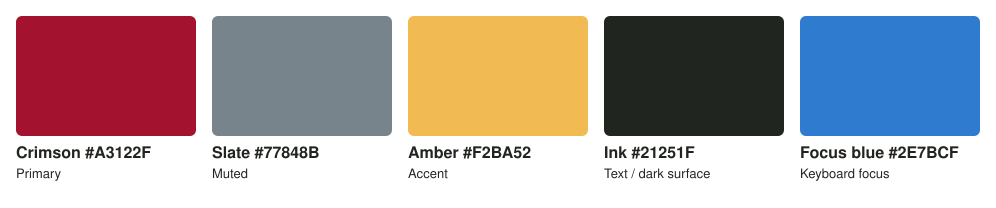

# UI palette

The color palette for CADD Calculator's interface. Every edition uses it, branded or not.
The maintainer designed it in Adobe Color on 2026-10-17. The original export is
[palette-source-adobe-color.jpeg](palette-source-adobe-color.jpeg).

| Name | Hex | RGB | Role |
|---|---|---|---|
| Crimson | `#A3122F` | 163, 18, 47 | Primary: main buttons, selection, headings on light |
| Slate | `#77848B` | 119, 132, 139 | Muted: borders, dividers, icons, disabled states |
| Amber | `#F2BA52` | 242, 186, 82 | Accent: highlights, warnings; headings and links on dark |
| Ink | `#21251F` | 33, 37, 31 | Text on light; the background in dark mode |

White (`#FFFFFF`) is the light-mode background and the text color in dark mode.

**Source of truth:** [`src/caddcalc/gui/assets/palette.toml`](../../../src/caddcalc/gui/assets/palette.toml),
which ships with the app. It defines the colors and the role mapping for the light and dark
themes. Change colors there, then update this page and regenerate the swatch image.

## Contrast (WCAG 2.x)

| Pair | Ratio | Use it for |
|---|---|---|
| Ink on white | 15.6:1 | All text (AAA) |
| White on crimson | 7.8:1 | Text on primary buttons and badges (AAA) |
| Crimson on white | 7.8:1 | Headings and links in light mode (AAA) |
| Ink on amber | 8.8:1 | Text on highlights and warnings (AAA) |
| Amber on ink | 8.8:1 | Headings, links, and focus rings in dark mode (AAA) |
| Slate on ink | 4.0:1 | Borders and icons in dark mode; large text only |
| Slate on white | 3.8:1 | Borders and icons in light mode; large text only |
| Crimson on amber | 4.4:1 | Large text only |
| Crimson on ink | 2.0:1 | **Avoid** for text. In dark mode crimson is a fill, with white text on it. |
| Amber on white | 1.8:1 | **Avoid** for text. On white, amber is a fill, with ink text on it. |
| Slate with crimson or amber | ~2:1 | **Avoid** as text/background pairs |

4.5:1 is the WCAG AA minimum for normal text; 3:1 is the minimum for large text and for
UI parts such as borders and icons. `tests/test_palette.py` checks every role pair in
`palette.toml` against these minimums, so a color change that hurts readability fails CI.

## Icon colors

Icons are recolored per theme from the `icon*` roles in `palette.toml`
([icons.md](icons.md)). Every icon role keeps at least 3:1 against its background.

| Role | Light | Dark |
|---|---|---|
| `icon` (default) | slate | slate |
| `icon_active` | ink | white |
| `icon_error` | crimson | white (crimson on ink is too faint) |
| `icon_warning` | ink (amber on white is too faint) | amber |

Where a color can't be used, the icon's shape and the wording carry the meaning.

## Text and outline colors

Colored text and field borders in the GUI also come from roles, so they follow the light
and dark themes. A test keeps hex colors out of the GUI code except the palette loader
(`gui/icons.py`).

| Role | Light | Dark | Used for |
|---|---|---|---|
| `text_error` | crimson | white (crimson on ink is too faint) | "Check the inputs" and "Not applied" |
| `text_warning` | ink (amber on white is too faint) | amber | the Notes heading in results |
| `outline_error` | crimson | white | the border of a field whose text can't be used |
| `outline_note` | ink (amber on white is too faint) | amber | the border of a field a result note concerns |

Text roles keep at least 4.5:1 against the background, and outline roles at least 3:1.

## Rules of thumb

* Body text is ink on white (light) or white on ink (dark). Never slate, amber, or crimson
  for small text, except crimson on white.
* Crimson marks the main action and the current selection. Use it sparingly so it stays
  meaningful.
* Errors also use crimson. Pair an error with an icon and wording, never color alone, so
  it doesn't read as just another primary button.
* Warnings use an amber fill with ink text.
* Icons (Tabler) take their color from the `icon*` roles, substituted at load time for
  the current light or dark scheme.

## Not done yet

* The GUI takes its icon, text, and outline colors from the palette, but Qt's own widget
  theme isn't built from `palette.toml` yet; that is on the roadmap.
* Branding packs can't override the palette. If an edition ever needs its own colors,
  add an optional `palette` entry to the pack format (docs/dev/packaging.md).
